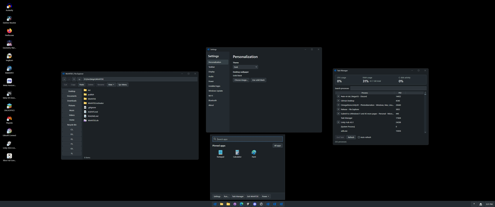

# WinNTDE
* Windows NT Desktop Environment (WinNTDE). Is a very lightweight explorer replacement for WinXP-Win11
* All DE features are implemented in a single process for max performance and least ram usage
* Boots using only 40mb of ram
* File-Explorer, settings and taskbar etc are just Windows of the main process
* Writen in C# .NET Framework 4.0 and WPF for max compatability on Windows

## Whats this for?
* Making low-memory or slow PCs feel fast or usable again
* Minimalist design users
* Max performance users
* Ideal for Fanless / Mini / Stick PCs or Servers

### Notes
* Windows Store (WinRT) apps will not run in this environment

